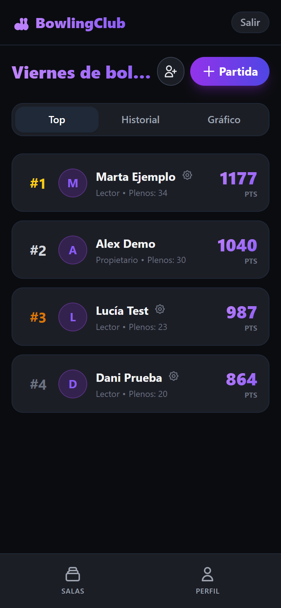
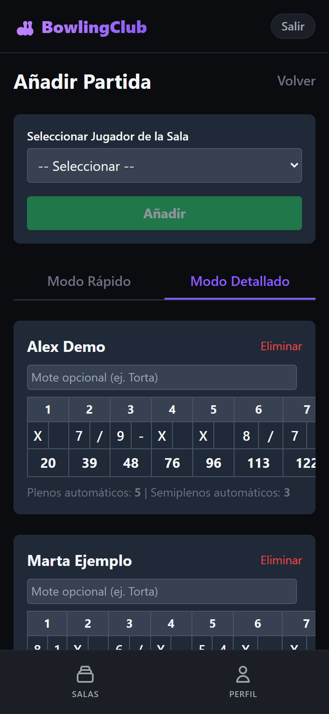
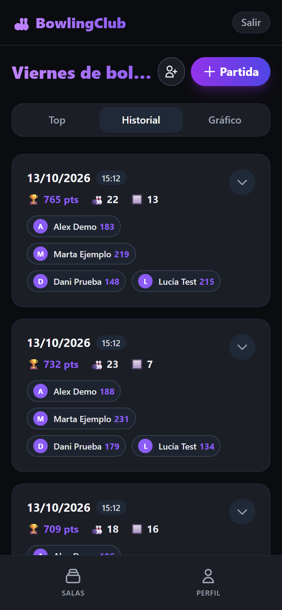
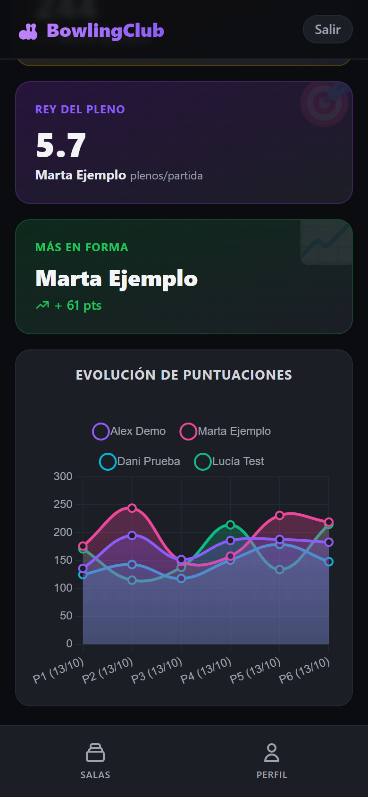

# 🎳 Bowling App

[](https://github.com/Elvictor20/bowling-app/actions/workflows/tests.yml)


[](LICENSE)

Aplicación web para apuntar las partidas de bolos que juegas con tus amigos: crea una sala, registra las puntuaciones de cada partida y consulta el ranking, el historial y las estadísticas del grupo. Pensada para usarse desde el móvil en la propia bolera.

<p align="center">
  
  
  
  
</p>

<p align="center"><sub>Capturas con datos de ejemplo.</sub></p>

## Funcionalidades

- **Salas**: cada grupo de amigos tiene su sala. El creador invita a otros usuarios por su nombre de usuario y les asigna un rol (*Propietario*, *Editor* o *Lector*); solo propietarios y editores pueden registrar partidas.
- **Registro de partidas** en dos modos:
  - **Rápido**: puntos, plenos y semiplenos de cada jugador.
  - **Detallado**: marcador completo tirada a tirada (`X`, `/`, `-`), con la puntuación acumulada, los plenos y los semiplenos calculados automáticamente.
- **Ranking** de la sala por puntos acumulados.
- **Historial** de partidas, con el marcador frame a frame de las registradas en modo detallado.
- **Estadísticas**: récord de la sala, *Rey del pleno* (más plenos por partida), jugador *Más en forma* y gráfico con la evolución de las puntuaciones.
- **Motes**: en cada partida se puede otorgar un mote a un jugador, que queda guardado en su perfil.
- **Perfil** con los totales del jugador y los motes que ha ido ganando.
- **Cuentas de usuario**: registro, inicio de sesión con JWT, contraseñas cifradas con bcrypt y recuperación de contraseña por correo (enlace válido durante 20 minutos).

## Tecnologías

| Capa | Herramientas |
| --- | --- |
| Backend | Python 3.11, FastAPI, SQLAlchemy, Pydantic |
| Base de datos | SQLite por defecto (cualquier base de datos compatible con SQLAlchemy mediante `DATABASE_URL`) |
| Frontend | Plantillas Jinja2, Tailwind CSS, Alpine.js y Chart.js (cargados por CDN) |
| Autenticación | JWT (`python-jose`) y bcrypt (`passlib`) |
| Tests y despliegue | pytest, GitHub Actions, Docker y Docker Compose |

## Puesta en marcha

### Con Docker

```bash
git clone https://github.com/Elvictor20/bowling-app.git
cd bowling-app
docker compose up --build
```

La aplicación queda disponible en <http://localhost:8000>. La base de datos se guarda en `./data/bowling.db`, fuera del contenedor, así que los datos se conservan entre reinicios.

### En local

```bash
python -m venv venv
source venv/bin/activate        # En Windows: venv\Scripts\activate
pip install -r requirements.txt
uvicorn app.main:app --reload
```

## Configuración

La aplicación se configura con variables de entorno. Con Docker Compose basta con copiar `.env.example` a `.env` y editar los valores; en local hay que exportarlas en la terminal antes de arrancar.

| Variable | Descripción | Valor por defecto |
| --- | --- | --- |
| `SECRET_KEY` | Clave con la que se firman los JWT. **Cámbiala** si vas a exponer la app. | Clave de ejemplo |
| `DATABASE_URL` | Cadena de conexión de SQLAlchemy. | `sqlite:///./data/bowling.db` |
| `SMTP_HOST`, `SMTP_PORT`, `SMTP_USER`, `SMTP_PASSWORD` | Servidor SMTP (con STARTTLS) para los correos de bienvenida y de recuperación de contraseña. | Sin definir |
| `EMAILS_FROM_NAME` | Nombre del remitente de los correos. | `Bowling Club App` |

Si no se configura el SMTP, los correos no se envían: se imprimen en la consola del servidor, incluido el enlace para restablecer la contraseña, lo que resulta cómodo para desarrollar.

## API

Además de las páginas, el backend expone una API REST bajo `/api`. FastAPI genera la documentación interactiva en <http://localhost:8000/docs>.

| Método | Ruta | Descripción |
| --- | --- | --- |
| `POST` | `/api/auth/register` | Crear una cuenta |
| `POST` | `/api/auth/login` | Iniciar sesión y obtener el token |
| `POST` | `/api/auth/forgot-password` | Pedir el enlace de recuperación |
| `POST` | `/api/auth/reset-password` | Establecer una nueva contraseña |
| `GET` | `/api/users/me` | Perfil, totales y motes del usuario |
| `GET` `POST` | `/api/rooms` | Listar mis salas / crear una sala |
| `GET` | `/api/rooms/{id}` | Datos de una sala |
| `GET` `POST` | `/api/rooms/{id}/members` | Listar / añadir miembros |
| `PATCH` | `/api/rooms/{id}/members/{user_id}` | Cambiar el rol de un miembro |
| `GET` `POST` | `/api/rooms/{id}/games` | Historial / registrar una partida |
| `GET` | `/api/rooms/{id}/leaderboard` | Ranking de la sala |
| `GET` | `/api/rooms/{id}/stats` | Récords y evolución de puntuaciones |

## Tests

```bash
pytest
```

Los tests cubren el registro e inicio de sesión, las salas y el ranking, el guardado de partidas detalladas, las estadísticas y el flujo de recuperación de contraseña. Se ejecutan automáticamente en cada *push* con GitHub Actions.

## Estructura del proyecto

```
app/
├── main.py          # Aplicación FastAPI y rutas de las páginas
├── auth.py          # Hash de contraseñas y JWT
├── database.py      # Conexión y sesión de SQLAlchemy
├── models.py        # Modelos: usuarios, salas, miembros, partidas, puntuaciones
├── schemas.py       # Esquemas Pydantic de la API
├── routers/         # Endpoints: auth, users, rooms
├── services/        # Envío de correos
└── templates/       # Páginas (Jinja2 + Alpine.js)
tests/               # Tests de la API
```

## Licencia

Distribuido bajo la licencia [MIT](LICENSE).
